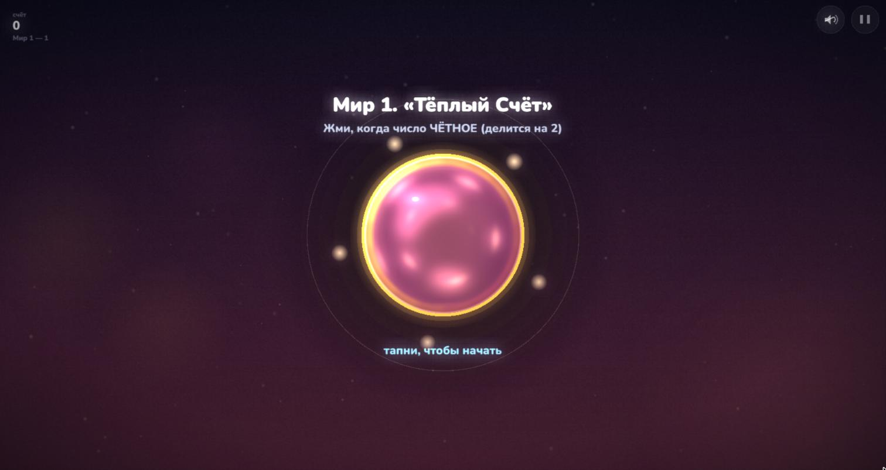
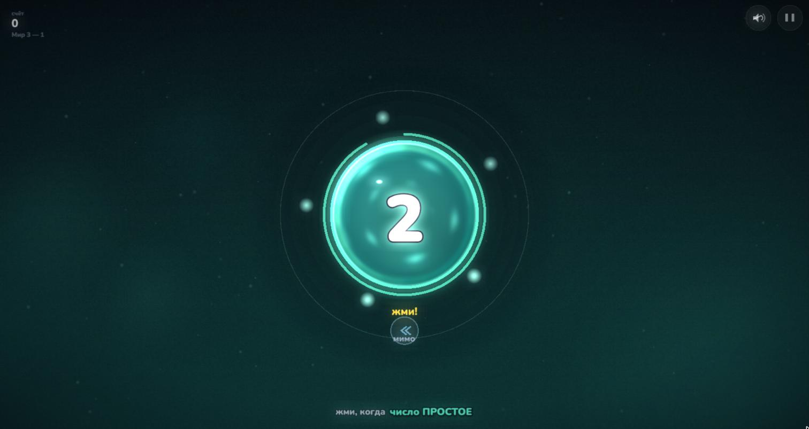
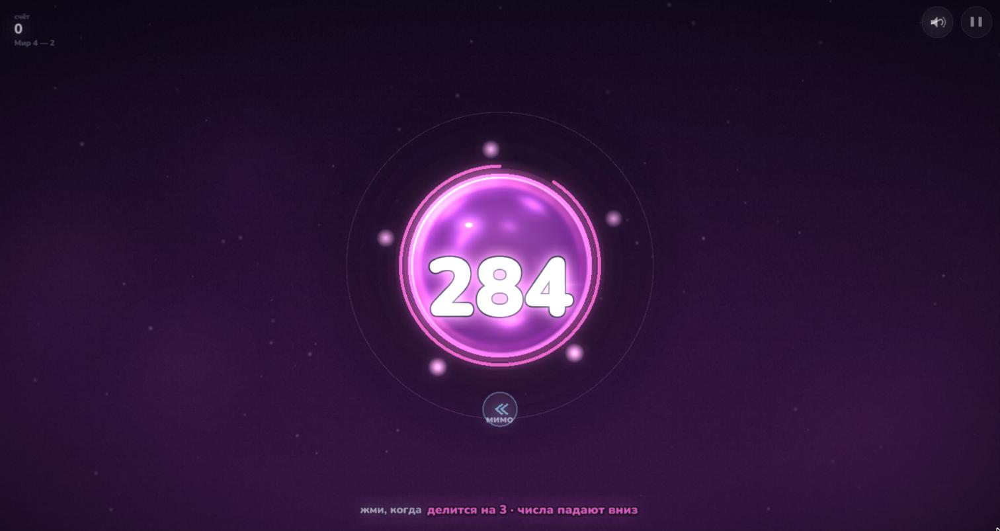

# Happy Math

A calm musical game about numbers. Tap the glowing disc when its number fits the rule
("even", "divisible by 3", "prime"…). Every tap is a note: right answers build a generative
melody, and each level ends with a portal into the next world.

[](https://play.google.com/store/apps/details?id=ru.neyvan.hm)
&nbsp; Play in the browser: **[lruns.itch.io/hm](https://lruns.itch.io/hm)**

| | | |
|---|---|---|
|  |  |  |

## What is inside

- **5 worlds x 17 levels**, from warm counting to prime numbers; star gates, milestones,
  surprises (gifts and tricks, tricks honestly crossed out), explanation cards for every rule.
- **Endless mode** and **number of the day**: one task for everyone, new every day.
- **Generative music**: WebAudio synthesis with no audio assets on the web; on Android the
  same music as pre-rendered loops (cheap on the phone's CPU). Combo curve drives the mix.
- **Progress is saved** mid-session; combos, lives, records, encyclopedia in pause.
- Stack: Vite + TypeScript + PixiJS v8, Capacitor for Android.

## Run

```bash
npm i
npm run dev            # web, http://localhost:5173
npm run sync           # build + copy into android/ (uses HM_LOOPS=1 for music loops)
scripts/build-android.sh   # signed release; keys live outside the repo (see android/app/build.gradle)
```

Signing keys, store listings and promo material are not in this repository.

## History

Happy Math started as a paper sketch in 2016 and was released on Google Play in 2020 as a
**libgdx** game. That code lives untouched in the branch
[`libgdx-2020`](../../tree/libgdx-2020) (tag `v1.0.2`) for historical reference.
The 2026 version on `main` is a full rewrite: web first, PixiJS, music played by your answers.
Both are published under the same app id, so the new version arrives as an update.

## License

GPL-3.0, see [LICENSE](LICENSE) (same as the 2020 version).
